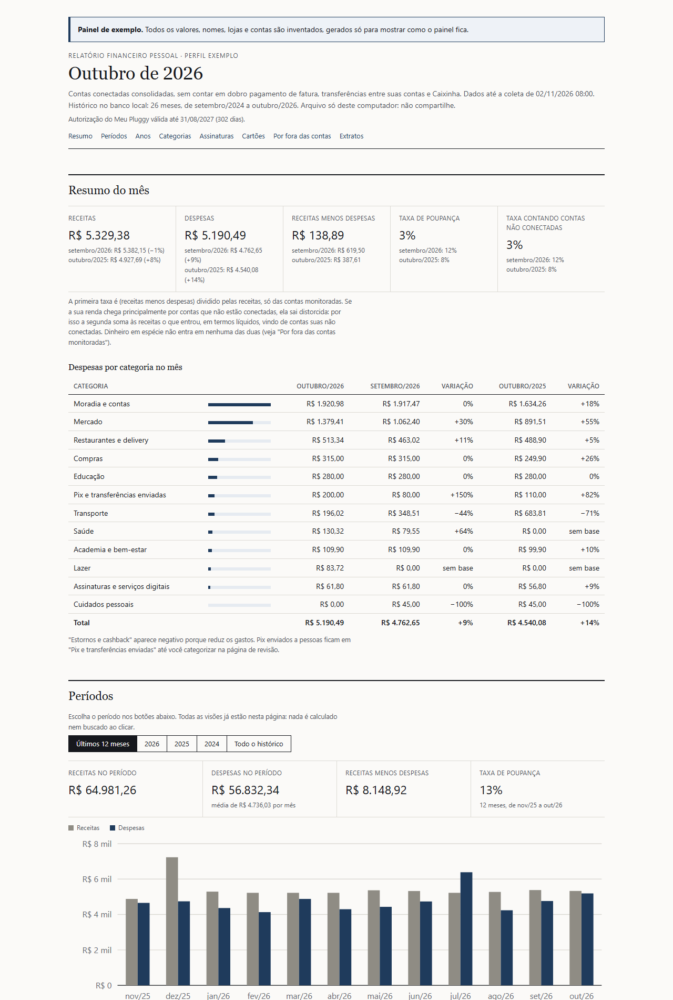

# Lastro

Uma alternativa gratuita aos aplicativos pagos de gestão financeira.

## Por que o Lastro existe

Criei o Lastro para ser o meu painel financeiro pessoal. Eu queria acompanhar contas e cartões
sem pagar a assinatura de um aplicativo e sem entregar os meus dados bancários a um serviço na
nuvem. Funcionou, e no caminho percebi que o trabalho tinha valor para mais gente.

Ele pode ajudar quem quer ficar atento às próprias finanças, usado como painel pessoal do jeito
que está. E pode servir de base para outras aplicações, como as que listo em
[Outros usos possíveis](#outros-usos-possíveis). Foi por isso que resolvi publicar.

O Lastro lê as suas contas e cartões pelo Open Finance, guarda tudo num banco de dados no seu
próprio computador e monta um painel mensal com receitas, despesas por categoria, cartões e a
evolução ao longo dos anos. Não tem servidor, não tem assinatura e não envia os seus dados para
ninguém: a única coisa que sai do computador são as chamadas à Pluggy, só de autenticação e
leitura. A Pluggy é a empresa que faz a ponte com os bancos.

O nome do projeto é Lastro; os comandos e a pasta do código se chamam `financas`.

## Para quem é

- Para quem tem conta em bancos brasileiros que participam do Open Finance e quer saber para onde
  vai o dinheiro sem pagar um aplicativo nem entregar os dados a um serviço na nuvem.
- Para quem usa Windows e topa digitar alguns comandos no PowerShell. O passo a passo abaixo
  mostra cada um.
- Foi testado com Nubank e Banco do Brasil. Outros bancos devem funcionar, mas as regras de
  categorização podem precisar de ajuste.
- Para quem quer construir outra coisa em cima dele (veja "Outros usos possíveis").
- Não é para quem quer lançar gastos à mão, montar orçamento com metas ou acompanhar
  investimentos (veja "Limitações conhecidas").

## Como é o painel



O painel é uma página HTML que abre no navegador, sem internet e sem JavaScript. Ele mostra:

- o resumo do último mês fechado: receitas, despesas, quanto sobrou e a taxa de poupança, cada
  um comparado com o mês anterior e com o mesmo mês do ano anterior;
- as despesas por categoria no mês, com as mesmas comparações;
- visões prontas por período (últimos 12 meses, cada ano e todo o histórico), com gráfico e
  tabela mês a mês;
- a visão por ano, comparando os mesmos meses de um ano com os do outro;
- despesas por categoria e ano, e o detalhamento de cada categoria;
- assinaturas e cobranças recorrentes, com destaque para as que ficaram mais caras;
- os cartões: limite utilizado, fatura fechada que falta pagar, fatura aberta e parcelas
  futuras, compras parceladas e a conferência das faturas fechadas;
- o que fica por fora das contas monitoradas: Caixinhas e aplicações, fatura paga em espécie e
  transferências para contas suas que não estão conectadas.

A pasta [`exemplo/`](exemplo/) tem um painel completo gerado com dois anos de dados totalmente
inventados. Baixe o arquivo `exemplo/painel.html` e abra no navegador para explorar.

## Outros usos possíveis

O uso principal é o painel pessoal, pronto para usar. Mas a parte difícil (ler os bancos pelo
Open Finance, limpar e mascarar os textos, categorizar e guardar o histórico) serve de base para
outras aplicações. Estas três aproveitam boa parte do que já existe. Nenhuma está pronta: são
caminhos para quem quiser adaptar o código. Em cada uma, **Aproveita** diz o que o Lastro já tem
e **Falta** diz o que precisaria mudar.

1. **Auditor de reajustes silenciosos.** Acompanhar só as cobranças recorrentes e avisar quando
   uma assinatura ou mensalidade ficou mais cara.
   **Aproveita:** boa parte já existe, porque o painel lista as cobranças recorrentes e marca as
   que subiram. **Falta:** rodar só essa parte, com um aviso; manter na lista os reajustes
   grandes (hoje, uma cobrança que varia mais de 35% sai da lista); e separar a variação do câmbio
   nas cobranças em dólar.
2. **Apoio à declaração do Imposto de Renda.** Listar os pagamentos de saúde e educação do ano,
   para achar os recibos, e os totais recebidos.
   **Aproveita:** as categorias Saúde e Educação e o histórico. **Falta:** um relatório anual
   por categoria, com data e recebedor. Nem tudo nessas categorias é dedutível (farmácia e cursos
   livres, por exemplo), e o relatório não substitui recibos nem informes de rendimentos.
3. **Ponte para gerenciadores de orçamento estrangeiros.** O YNAB (pago) e o Firefly III
   (aberto) não se conectam a bancos brasileiros, e o Actual Budget (aberto) tem só uma
   integração experimental com a própria Pluggy. O Lastro pode alimentá-los com os seus
   lançamentos já limpos e categorizados.
   **Aproveita:** coleta, banco local, máscaras e categorias. **Falta:** um exportador CSV, que
   os três importam (YNAB e Actual também aceitam OFX), e um mapa entre as categorias. Envio
   automático, só para Actual ou Firefly rodando no seu computador.

E outras que eu ainda não imaginei. É por isso que publico o trabalho.

Qualquer adaptação que mande dados para fora do computador (outro aplicativo, e-mail, uma IA na
nuvem) muda o modelo de privacidade do Lastro. Faça com cuidado e deixe isso claro para quem for
usar.

## Requisitos

- **Windows 10 ou 11.** Como o banco de dados fica no seu computador, use disco criptografado
  (BitLocker ou Criptografia de dispositivo) e login com senha.
- **Python 3.14** (testado no 3.14.4), com o inicializador `py`, que vem no instalador do
  python.org e no da Microsoft Store. Nenhum pacote extra: só a biblioteca padrão.
- **Conta no Meu Pluggy** ([meu.pluggy.ai](https://meu.pluggy.ai)), onde você conecta os seus
  bancos pelo Open Finance.
- **Conta no dashboard da Pluggy** ([dashboard.pluggy.ai](https://dashboard.pluggy.ai)), onde
  você cria as aplicações que dão acesso de leitura aos dados. Entre com a mesma conta do Meu
  Pluggy.

## Instalação passo a passo

### 1. Baixe o projeto

1. No GitHub, clique em **Code** e depois em **Download ZIP**.
2. Descompacte numa pasta dentro da sua pasta de usuário e fora de qualquer pasta sincronizada
   com a nuvem, por exemplo `C:\Users\<seu usuário>\Lastro`. Prefira um caminho sem espaços.

Em muitos computadores, a Área de Trabalho e a pasta Documentos ficam dentro do OneDrive, então
não use essas pastas. O programa se recusa a rodar dentro de OneDrive, Dropbox, Google Drive,
iCloud e parecidos, e também fora da sua pasta de usuário.

### 2. Instale o Python 3.14

1. Baixe o instalador em [python.org](https://www.python.org/downloads/windows/) e deixe marcada
   a opção do inicializador `py` (py launcher).
2. Abra o PowerShell e confira: `py -3.14 --version`. Se aparecer um erro, instale de novo
   marcando o inicializador `py`. Os atalhos `.cmd` procuram o `py` nos lugares em que os
   instaladores do python.org e da Microsoft Store o colocam.

### 3. Conecte os seus bancos no Meu Pluggy

Em [meu.pluggy.ai](https://meu.pluggy.ai), crie a sua conta e conecte cada banco. A autorização é
feita no app do próprio banco, na área de Open Finance.

### 4. Crie as aplicações no dashboard da Pluggy

Em [dashboard.pluggy.ai](https://dashboard.pluggy.ai), entre com a mesma conta e crie duas
aplicações:

- **`financas-teste`**, para testar com dados de mentira: em **Demo**, **Connect Account**,
  conecte o **Pluggy Bank**, o banco de testes da Pluggy. As credenciais de teste são públicas e
  estão na documentação da Pluggy (usuário `user-ok`, senha `password-ok`, código `123456`).
- **`financas`**, para os seus dados: em **Demo**, **Connect Account**, escolha **MeuPluggy** e
  entre com a conta do Meu Pluggy. Cada banco vira um item. Anote os ids que aparecem em
  **Connected Items**.

Faça isso durante o período de teste (trial) do dashboard: depois dele, a lista de conectores
fica travada.

### 5. Guarde as credenciais

Abra o PowerShell na pasta do projeto e rode, um de cada vez:

```powershell
cd C:\Users\<seu usuário>\Lastro
.\financas.cmd configurar --perfil teste
.\financas.cmd configurar --perfil real
```

Cada comando pede o Client ID e o Client Secret da aplicação correspondente (`financas-teste`
para o perfil teste, `financas` para o real). Nenhum dos dois aparece na tela enquanto você cola.
O programa testa a credencial na Pluggy e só então guarda no Gerenciador de Credenciais do
Windows. No fim, ele pergunta se você quer cadastrar os itemIds: responda `s` e cole os ids
separados por vírgula. Para trocar os ids depois, use `.\financas.cmd itens --perfil real`.

Quando terminar, limpe a área de transferência: Win+V e depois "Limpar tudo".

### 6. Faça a primeira coleta

```powershell
.\financas.cmd verificar --perfil real
.\financas.cmd coletar --perfil real --saldos
```

O `verificar` mostra o status de cada conexão e até quando vale a autorização. A primeira coleta
traz todo o histórico que o banco entrega pelo Open Finance; as seguintes releem os últimos 60
dias, ou desde uma semana antes da última coleta que deu certo, se ela for mais antiga. Confira
os saldos mostrados com os apps dos bancos.

### 7. Categorize e gere o painel

```powershell
.\financas.cmd categorizar --perfil real
.\financas.cmd relatorio --perfil real
```

Na primeira vez, o `categorizar` avisa que as regras ainda não foram confirmadas. Digite
`CONFIRMO` e Enter (veja "Quando você muda as regras").

Depois abra o painel no navegador:

```powershell
start $env:USERPROFILE\financas-dados\relatorios\painel.html
```

Se quiser ver tudo funcionando antes com dados de mentira, rode os passos 6 e 7 com
`--perfil teste`. O painel de teste fica em `dados\teste\relatorios\`, dentro do projeto:

```powershell
start dados\teste\relatorios\painel.html
```

### 8. Tire a pasta de dados da Pesquisa do Windows

A Pesquisa do Windows guarda trechos do texto dos arquivos que indexa, inclusive dos painéis. Em
**Opções de Indexação**, clique em **Modificar** e desmarque a pasta
`C:\Users\<seu usuário>\financas-dados`.

## Uso mensal

### Automático

O `mensal.cmd` coleta, categoriza e gera o painel do último mês fechado. O log, só com contagens,
fica em `%USERPROFILE%\financas-dados\logs\mensal.log`. Para agendar no dia 2 de cada mês às
20:00, só com o seu usuário conectado (nenhuma senha vai para a tarefa), rode no PowerShell,
trocando o caminho pelo da sua pasta:

```powershell
schtasks --% /Create /TN financas-mensal /TR "\"C:\Users\<seu usuário>\Lastro\mensal.cmd\"" /SC MONTHLY /D 2 /ST 20:00 /IT /F
Set-ScheduledTask -TaskName financas-mensal -Settings (New-ScheduledTaskSettingsSet -StartWhenAvailable -AllowStartIfOnBatteries -DontStopIfGoingOnBatteries -ExecutionTimeLimit (New-TimeSpan -Hours 1))
```

As aspas da primeira linha deixam o caminho funcionar mesmo com espaço no nome do usuário. A
segunda faz a tarefa rodar assim que possível se o computador estava desligado no horário,
rodar também na bateria (num notebook) e parar depois de 1 hora. Na hora da rotina abre uma
janela preta que fecha sozinha: não feche. Para remover a tarefa:
`schtasks /Delete /TN financas-mensal /F`.

Para ver como foi a última execução: `Get-ScheduledTaskInfo -TaskName financas-mensal`. Em
`LastTaskResult`, 0 quer dizer tudo certo, 3 quer dizer que a rotina parou porque as regras
mudaram e ainda não foram confirmadas, e qualquer outro número é erro. O fim do log diz em que
etapa parou: `OK`, `PARADO` ou `ERRO`.

Se a coleta falhar (sem rede, autorização vencida, credencial recusada), o painel antigo ganha no
topo o aviso **Painel desatualizado**, que some no próximo painel gerado. Se a coleta der certo
mas um banco não sincronizar há mais de uma semana, o painel novo traz no topo o aviso **Dados
possivelmente parados**. Nos dois casos, veja "Se der erro", mais abaixo.

### Manual

Rode no PowerShell, na pasta do projeto:

```powershell
.\financas.cmd coletar --perfil real
.\financas.cmd categorizar --perfil real
.\financas.cmd relatorio --perfil real
```

### Todos os comandos

| Comando | O que faz |
|---|---|
| `.\financas.cmd configurar --perfil real` | Guarda Client ID e Client Secret |
| `.\financas.cmd itens --perfil real` | Cadastra os itemIds (um por banco) |
| `.\financas.cmd verificar --perfil real` | Mostra o status das conexões e a validade da autorização |
| `.\financas.cmd coletar --perfil real` | Lê contas, lançamentos e faturas (`--saldos` mostra os saldos; `--desde AAAA-MM-DD` relê a partir de uma data) |
| `.\financas.cmd categorizar --perfil real` | Categoriza e gera a página de revisão (`--detalhar` mostra contagens por conta, categoria e regra; `--so-contagens` tira as somas; `--com-somas` mostra as somas no real, só no seu terminal) |
| `.\financas.cmd relatorio --perfil real` | Gera o painel do último mês fechado (`--mes AAAA-MM` para outro mês) |
| `.\mensal.cmd` | Coleta, categoriza e gera o painel de uma vez, com o log em `financas-dados\logs` (é o que a tarefa agendada roda) |
| `.\financas.cmd configurar --perfil real --apagar` | Apaga a credencial e os itemIds do perfil (no real, pede para digitar APAGAR) |
| `.\testes.cmd` | Roda os testes automáticos |

`--saldos` e `--com-somas` mostram valores do perfil real e só rodam numa janela do PowerShell
aberta por você, nunca pela tarefa agendada nem por um assistente de IA.

### Renovação anual

A autorização do Meu Pluggy para a aplicação vale 1 ano. O `verificar` e o painel mostram a data
e avisam quando faltar menos de 30 dias. Para renovar: no dashboard, aplicação `financas`,
**Demo**, **Connect Account**, **MeuPluggy**. Depois confira em **Connected Items** se os itemIds
mudaram. Se mudaram, rode `.\financas.cmd itens --perfil real` e cole só os ids novos. Na coleta
seguinte, o programa liga cada conta antiga à conta equivalente do item novo (mesmo banco, mesmo
tipo, mesmo final) e o histórico não conta em dobro: os lançamentos antigos valem até o primeiro
dia que o item novo entregar.

### Se der erro

1. Rode `.\financas.cmd verificar --perfil real`: ele mostra o status de cada conexão e a
   validade da autorização.
2. Autorização vencida ou conexão com erro (por exemplo `LOGIN_ERROR` ou `OUTDATED`): renove
   como em "Renovação anual". Se o problema for num banco só, reconecte esse banco no Meu
   Pluggy.
3. **Dados possivelmente parados** (o banco não sincroniza há mais de uma semana): abra o Meu
   Pluggy e confira se a conexão daquele banco está ativa; se não estiver, reconecte. Depois da
   volta, a coleta seguinte relê desde antes da parada.
4. Coleta que falhou por rede ou por instabilidade da Pluggy: espere e rode `.\mensal.cmd` de
   novo (ou os três comandos de "Manual"). Nada se perde: a coleta relê desde antes da última
   que deu certo.
5. A tarefa terminou com 3: as regras mudaram e falta o CONFIRMO (veja "Quando você muda as
   regras").
6. O log `%USERPROFILE%\financas-dados\logs\mensal.log` diz em que etapa parou. Ele só tem
   contagens e números mascarados.
7. Compra em moeda estrangeira: o programa usa o valor em reais que a Pluggy informa. Se ela não
   informar, a coleta avisa e o lançamento entra com o valor da moeda original até uma coleta
   seguinte trazer o valor em reais.

Se nada disso resolver, abra uma issue no GitHub sem Client ID, Client Secret, itemIds nem
trechos do log.

### Backup

O histórico fica só no seu computador, e a Pluggy reentrega só cerca de 12 meses. Se o disco
falhar sem backup, os meses mais antigos se perdem. Uma cópia por mês num pendrive criptografado
resolve sem usar a nuvem:

1. Uma vez só: no Explorador de Arquivos, clique com o botão direito no pendrive, **Ativar o
   BitLocker**, **Usar uma senha para desbloquear a unidade**. Imprima ou anote a chave de
   recuperação; não guarde a chave no próprio pendrive. Sem o BitLocker (por exemplo, no Windows
   Home), use outra forma de criptografar o pendrive.
2. Todo mês, depois do painel do dia 2 (com a rotina já terminada), desbloqueie o pendrive e rode
   no PowerShell, na pasta do projeto, trocando `E:` pela letra do pendrive:

   ```powershell
   robocopy "$env:USERPROFILE\financas-dados" "E:\financas-dados" /E /R:1 /W:1 /XF *.tmp
   robocopy . "E:\lastro-config" *.local.* /S /R:1 /W:1
   ```

   O primeiro copia o banco, os painéis e o log; o segundo, os seus arquivos `*.local.*` (regras,
   ajustes, itemIds e permissões). Com `/E`, nada é apagado no pendrive.
3. Ejete o pendrive e guarde longe do computador.

Para restaurar, copie as duas pastas de volta. A credencial não vai para o backup: se precisar,
gere um Client Secret novo no dashboard e rode `.\financas.cmd configurar --perfil real`.

### Ajustar as categorias

Ajustar categorias é opcional: o painel funciona sem isso. Se quiser:

- crie um `regras.local.toml` na pasta do projeto, no mesmo formato do `regras.toml`, com as suas
  regras (as lojas que você frequenta, o seu empregador, categorias novas). Ele fica fora do
  repositório e vem antes das regras genéricas;
- a página de revisão, gerada pelo `categorizar`, lista os lançamentos duvidosos e sugere a linha
  para decidir cada um num `ajustes.local.toml`.

Não coloque nada pessoal no `regras.toml`: ele é o arquivo genérico, que vai para o repositório.

### Quando você muda as regras: CONFIRMO

Mudar uma regra e comparar os resultados antes e depois pode revelar detalhes de lançamentos.
Por isso, regras e ajustes novos só valem depois que você confirma no seu terminal:

1. Mude `regras.toml`, `regras.local.toml` ou `ajustes.local.toml`.
2. Numa janela do PowerShell aberta por você, rode `.\financas.cmd categorizar --perfil real`.
3. O programa avisa que as regras mudaram. Se foi você quem mudou, digite `CONFIRMO` e Enter. Se
   não foi, aperte só Enter e confira esses arquivos: nada muda. Se um arquivo tiver erro de
   formato, o programa mostra o erro antes de perguntar e nada é confirmado.
4. Rode `.\financas.cmd relatorio --perfil real` para atualizar o painel.

Enquanto você não confirma, a tarefa mensal para sem classificar nada, escreve no log uma linha
que começa com `PARADO` e põe no painel antigo o aviso **Painel desatualizado**. A pergunta só
aparece num console de verdade: um comando com a entrada ou a saída redirecionada, como os da
tarefa agendada ou os de um assistente de IA, nunca confirma nada.

## Segurança e privacidade

- **Somente leitura.** O código só faz `POST /auth` e `GET` de `/items/{id}`, `/accounts`,
  `/v2/transactions` e `/bills`, todos em `https://api.pluggy.ai`. O arquivo
  `financas/pluggy.py` recusa qualquer outra chamada antes de ela sair do computador. Nada de
  pagamentos, Pix, criação, alteração ou exclusão de conexões.
- **Só contas, cartões, lançamentos e faturas.** A autorização do Meu Pluggy também libera
  identidade, investimentos e empréstimos, mas o código nunca chama esses endpoints, e um teste
  automático garante isso.
- **Nada vai para a nuvem.** Sem servidor, sem telemetria e sem pacotes de terceiros. Os dados
  ficam num banco SQLite em `%USERPROFILE%\financas-dados`, fora da pasta do projeto, para não
  irem parar no GitHub por engano e para ficarem longe de um assistente de IA aberto na pasta do
  projeto.
- **O Client Secret nunca aparece na tela nem fica em arquivo.** Ele é digitado sem eco e
  guardado no Gerenciador de Credenciais do Windows, só neste computador.
- **Dados mascarados.** Números de conta e cartão aparecem sempre mascarados. Em descrições e
  nomes, sequências de 5 ou mais dígitos são gravadas como `••••` mais os 4 últimos. O CPF do
  titular, que vem na resposta da API, é usado só em memória para reconhecer transferências
  entre as suas contas e nunca é gravado completo.
- **Python isolado.** Os atalhos `financas.cmd` e `testes.cmd` rodam o Python com `-I -S`: sem
  variáveis `PYTHON*`, sem pacotes instalados e sem a pasta atual no caminho de busca. Um arquivo
  com nome de módulo do Python (`json.py`, por exemplo) deixado na pasta do projeto nunca é
  executado no lugar do original.
- **Painel fechado.** O painel é HTML puro, com uma política que impede carregar qualquer coisa
  de fora. Ele tem os seus dados: não compartilhe.
- **Perfil teste separado.** O perfil teste só aceita itens do banco de testes da Pluggy e
  recusa uma pasta `dados\teste` que seja atalho para outro lugar.

### Onde fica cada coisa

| O quê | Onde |
|---|---|
| Client ID e Client Secret | Gerenciador de Credenciais do Windows, `financas-pluggy-real` e `financas-pluggy-teste` |
| itemIds | `config.local.json`, na pasta do projeto (fora do repositório; não é segredo) |
| Banco de dados real | `%USERPROFILE%\financas-dados\real\financas.sqlite3` |
| Marca das regras confirmadas | `%USERPROFILE%\financas-dados\real\regras-confirmadas.sha256` |
| Painel e página de revisão | `%USERPROFILE%\financas-dados\relatorios\` |
| Log da tarefa mensal | `%USERPROFILE%\financas-dados\logs\mensal.log` |
| Dados e painel de teste | `dados\teste\`, dentro do projeto |

### Arquivos pessoais

Tudo que é seu fica em arquivos `*.local.*`, que estão no `.gitignore` e nunca vão para o
repositório: `config.local.json`, `regras.local.toml`, `ajustes.local.toml`, `CLAUDE.local.md`,
`PROGRESSO.local.md` e `.claude/settings.local.json`.

### Se você usa um assistente de IA no projeto

O projeto foi pensado para ser mantido com ajuda de um assistente de IA sem que ele veja os seus
dados reais. Se você usar um (o Claude Code, por exemplo):

- As regras para o assistente estão no [`CLAUDE.md`](CLAUDE.md). A principal: ele só vê totais
  e dados mascarados, e os detalhes você confere no painel.
- O [`.claude/settings.json`](.claude/settings.json) bloqueia a leitura e a escrita da pasta
  `financas-dados` pelas ferramentas do assistente, bloqueia ferramentas do app que poderiam
  levar dados para fora e pede aprovação para editar código e configuração e para os comandos do
  PowerShell que gravam ou apagam arquivos. Bloqueia também o navegador do app, o Claude in Chrome
  e o controle do computador, que abririam o painel sem passar pelo bloqueio de leitura.
- Use o assistente no modo padrão (pedir aprovação), não no "Aceitar edições". O bloqueio de
  leitura não vale para comandos do PowerShell: leia cada comando antes de aprovar.
- `--saldos` e `--com-somas` mostram valores e por isso só rodam no seu terminal. Com a entrada ou
  a saída redirecionada, como acontece com o assistente, o comando recusa.
- Os conectores da sua conta (Drive, Notion e outros) têm identificadores próprios, que não dá
  para pôr num arquivo público. Bloqueie os seus num `.claude/settings.local.json`, junto com o
  caminho completo da pasta de dados. O identificador aparece no nome das ferramentas do
  conector, no formato `mcp__<identificador>__<ferramenta>`:

  ```json
  {
    "permissions": {
      "deny": [
        "mcp__<identificador-do-conector>__*",
        "Read(//c/Users/<seu usuário>/financas-dados/**)",
        "Edit(//c/Users/<seu usuário>/financas-dados/**)"
      ]
    }
  }
  ```

- Para o bloqueio da pasta de dados valer também em sessões abertas noutras pastas, ponha
  `Read(~/financas-dados/**)` e `Edit(~/financas-dados/**)` no `deny` do
  `%USERPROFILE%\.claude\settings.json`.

## Como revogar tudo

1. **Bancos:** no app de cada banco, na área de Open Finance, revogue o compartilhamento com a
   Pluggy.
2. **Meu Pluggy:** em meu.pluggy.ai, remova as conexões. Excluir a conta do Meu Pluggy encerra a
   autorização na hora.
3. **Dashboard:** em dashboard.pluggy.ai, exclua as aplicações `financas` e `financas-teste`.
4. **Este computador:**
   - remova a tarefa agendada: `schtasks /Delete /TN financas-mensal /F`;
   - apague as credenciais: `.\financas.cmd configurar --perfil real --apagar` e o mesmo com
     `--perfil teste`;
   - apague a pasta `%USERPROFILE%\financas-dados` (banco, painéis, log e marca das regras) e a
     pasta `dados` do projeto;
   - apague os arquivos pessoais do projeto (`config.local.json`, `regras.local.toml`,
     `ajustes.local.toml`, `CLAUDE.local.md`, `PROGRESSO.local.md` e
     `.claude\settings.local.json`), ou a pasta do projeto inteira;
   - se você usou o Claude Code, apague as conversas deste projeto em
     `%USERPROFILE%\.claude\projects\` (a pasta cujo nome é o caminho do projeto);
   - limpe o histórico da área de transferência (Win+V, "Limpar tudo") e esvazie a Lixeira;
   - se a pasta de dados chegou a entrar na Pesquisa do Windows, recrie o índice (Opções de
     Indexação, Avançado, Recriar).

## Limitações conhecidas

- Só funciona no Windows: a credencial fica no Gerenciador de Credenciais do Windows e os atalhos
  são arquivos `.cmd`.
- Dinheiro em espécie, investimentos, empréstimos e contas não conectadas não aparecem.
  Pagamento de fatura que só aparece no cartão e transferências de contas suas não conectadas
  ficam fora de receitas e despesas; o painel mostra esses valores à parte, com uma segunda taxa
  de poupança que conta as entradas de contas não conectadas.
- O histórico disponível depende do que cada banco entrega pelo Open Finance.
- A categoria automática da Pluggy só vem durante o trial do dashboard. Depois, valem as regras
  do `regras.toml` e do seu `regras.local.toml`, e parte dos lançamentos pode cair em "Sem
  categoria".
- O Pix no crédito é reconhecido pelo nome da pessoa e pelo valor (mesmo dia, até 25% de taxa).
- Cartões: o painel usa os números do banco (limite utilizado e fatura fechada). A fatura aberta e
  as parcelas futuras aparecem somadas, porque a divisão entre elas não é confiável, e a lista de
  compras parceladas é uma estimativa.
- Parcelamento cancelado é detectado automaticamente: um crédito no mesmo cartão, com o valor de
  uma parcela ou da compra inteira e com o nome da loja ou um texto de estorno ou cancelamento.
  Ainda pode errar se um estorno sem relação tiver o mesmo valor, por isso esses lançamentos ficam
  como duvidosos na página de revisão.
- A conferência das faturas fechadas é só informativa: juros ou IOF que não aparecem como
  lançamento podem fazer uma fatura não fechar.
- Foi testado com Nubank e Banco do Brasil. Em outros bancos, descrições diferentes podem pedir
  regras novas.

## Avisos

- **Sem garantia.** O Lastro é distribuído como está, sem garantia de nenhum tipo (veja a
  [licença](LICENSE)). Confira os números com os extratos do banco antes de tomar qualquer
  decisão.
- **Não é aconselhamento financeiro.** O Lastro só organiza e soma os seus lançamentos. Ele não
  recomenda produtos, investimentos nem decisões.
- **Sem vínculo com a Pluggy nem com os bancos.** É um projeto independente. Pluggy, Meu Pluggy,
  Nubank, Banco do Brasil e os demais nomes citados são marcas dos seus donos.
- **O acesso gratuito depende da Pluggy.** O Lastro usa o Meu Pluggy e o dashboard da Pluggy nas
  condições que a Pluggy oferece hoje para uso pessoal. Se essas condições mudarem (limites,
  cobrança ou fim do acesso), a coleta pode parar de funcionar. Leia os termos de uso da Pluggy
  antes de começar.

## Como foi feito

O Lastro foi desenvolvido com auxílio do Claude Code, o assistente de programação da Anthropic.
O código passou por revisões de segurança feitas por revisores independentes (sessões separadas
do assistente, sem acesso a dados reais), com foco em vazamento de dados, chamadas à API e
proteção da credencial. Os achados graves foram corrigidos antes desta versão. Essas revisões não
substituem uma auditoria profissional.

## Testes

`.\testes.cmd` roda os testes automáticos. Eles usam só dados sintéticos, sem rede e sem
credencial.

## Como contribuir

Sugestões e correções são bem-vindas. Antes, leia o [`CONTRIBUTING.md`](CONTRIBUTING.md): ele
explica as regras que protegem os dados de quem usa.

## Licença

[MIT](LICENSE).
